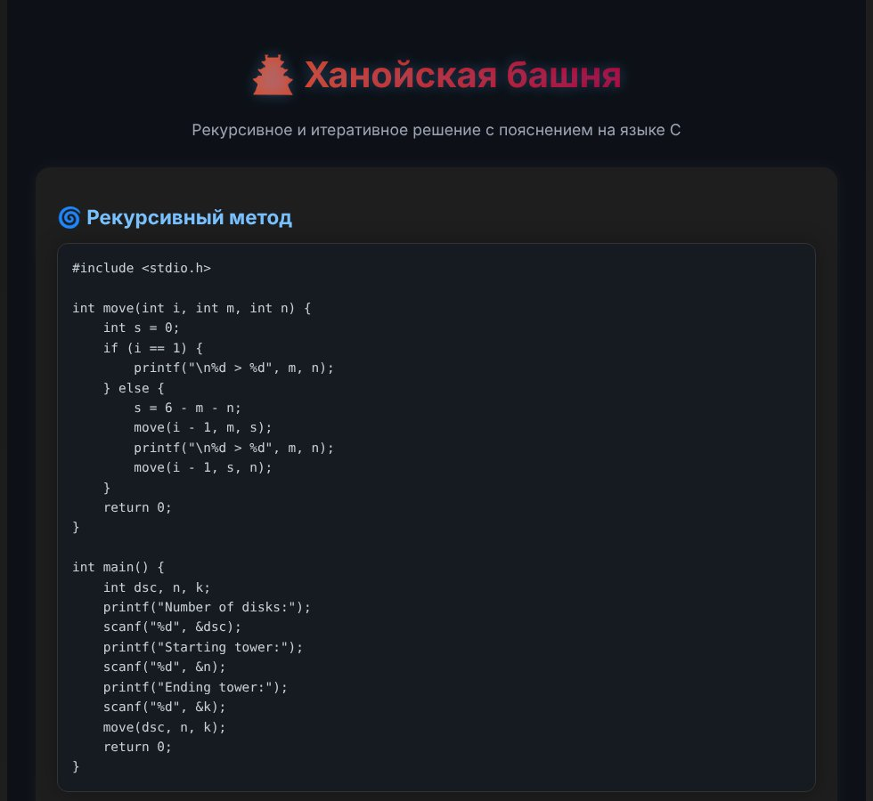

<div align="center">

# 🏯 Ханойская башня

**Сайт с рекурсивным и итеративным решением задачи о Ханойской башне на языке C — с кодом и подробными пояснениями.**

[](https://hanoi-tower-site.vercel.app)


**[Открыть сайт →](https://hanoi-tower-site.vercel.app)**



</div>

---

## 📖 О проекте

Ханойская башня — классическая задача: перенести стопку из `n` дисков с одного стержня на другой. За ход можно переложить только один диск, и класть больший диск на меньший нельзя. Минимальное число ходов — **2ⁿ − 1**.

На сайте разобраны два способа решения:

| | Метод | Идея |
|---|---|---|
| 🌀 | **Рекурсивный** | Перенести `n − 1` дисков на вспомогательный стержень, нижний диск — на целевой, затем `n − 1` дисков — поверх него |
| ⚙️ | **Итеративный** | Без рекурсии: номер диска на каждом ходе определяется двоичной записью номера хода, а направление — чётностью числа дисков |

Для каждого метода есть полный код на C, пошаговое объяснение логики и таблица с примером, какой диск перемещается на каждом ходе.

## ✅ Проверка решений

Оба алгоритма проверены. Программы скомпилированы и запущены для всех комбинаций от 1 до 8 дисков и всех пар «начальная → конечная башня». Каждое решение корректно: ни разу больший диск не лёг на меньший, и ходов ровно 2ⁿ − 1.

Пример вывода для 3 дисков с башни 1 на башню 3:

```text
1 > 3
1 > 2
3 > 2
1 > 3
2 > 1
2 > 3
1 > 3
```

Запустить код у себя:

```bash
gcc hanoi.c -o hanoi -lm
./hanoi
```

> Флаг `-lm` нужен итеративной версии: она использует `pow` из `math.h`.

## 🧰 Стек

- **React 19** — интерфейс
- **Vite 7** — сборка и dev-сервер
- **CSS** — тёмная тема, анимации появления, адаптивная вёрстка под телефон
- **Vercel** — хостинг

## 🚀 Запуск локально

Нужен [Node.js](https://nodejs.org/) 20 или новее.

```bash
git clone https://github.com/ArtaTOPprog/Hanoi_tower_site.git
cd Hanoi_tower_site
npm install
npm run dev
```

Сайт откроется на http://localhost:5173.

| Команда | Что делает |
|---|---|
| `npm run dev` | Dev-сервер с горячей перезагрузкой |
| `npm run build` | Сборка в папку `dist/` |
| `npm run preview` | Просмотр собранной версии |
| `npm run lint` | Проверка кода ESLint |

## 📁 Структура

```text
Hanoi_tower_site/
├── index.html            # HTML-шаблон, заголовок и мета-теги для поиска
├── public/
│   ├── favicon.svg       # иконка сайта
│   ├── robots.txt
│   └── sitemap.xml
├── src/
│   ├── main.jsx          # точка входа React
│   ├── App.jsx           # страница: код на C и объяснения
│   └── App.css           # стили
├── docs/preview.jpg      # скриншот для README
├── vite.config.js
└── package.json
```

## 🌐 Деплой

Сайт публикуется на [Vercel](https://vercel.com/): после изменений в ветке `main` Vercel сам собирает проект (`npm run build`) и выкладывает папку `dist/`.

## 👥 Авторы

- **Муфахаров Артур** — KE-25-02
- **Капаев Семён** — KA-25-06

<div align="center">

Сделано с ❤️ в помощь всем, кто разбирается с рекурсией

</div>
